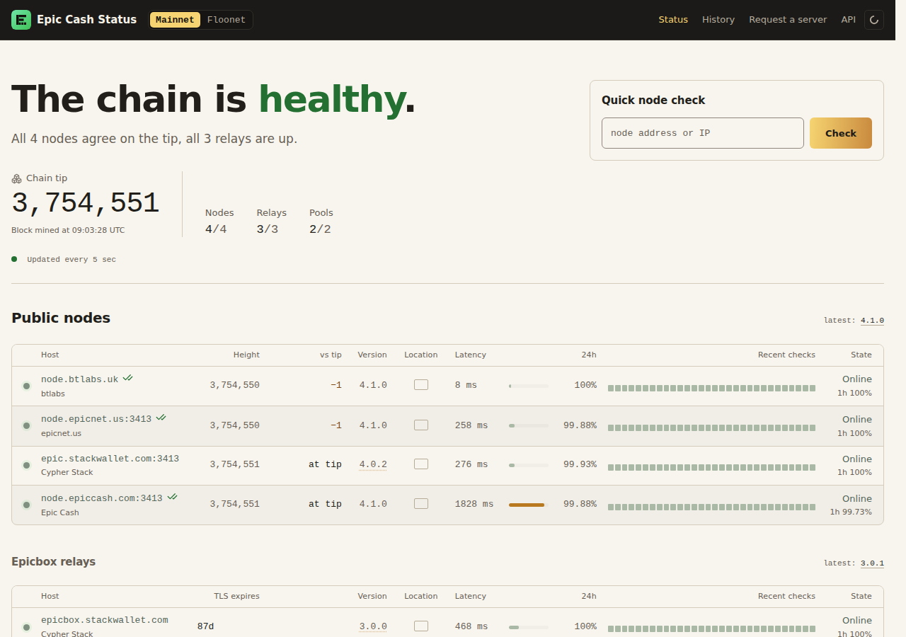

<div align="center">


# epic-status

**The live status of Epic Cash nodes, Epicbox relays and BT Labs services.**

[](LICENSE)
[](.python-version)

[Run from source](#run-from-source) · [Deployment](#deployment) · [Security](SECURITY.md) ·
[Documentation](https://docs.btlabs.uk)

</div>

epic-status is the dashboard behind <https://status.btlabs.uk>. It checks public Epic Cash nodes,
Epicbox relays and mining pools on mainnet and floonet, and shows which are up, in sync and on the
same chain. It also watches BT Labs' own services, and offers a JSON API (`/api/v1/status.json`),
a quick check for anyone's host and a mirror as a Tor onion service.



> **Status: in production.** It has run status.btlabs.uk since 2026. The configuration and the
> API may still change.

## Run from source

Requirements: Linux, [uv](https://docs.astral.sh/uv/) and Python 3.12 (see `.python-version`),
and outbound HTTPS/WSS to the hosts you monitor.

```sh
git clone https://gitlab.com/bt-labs-group/epic-status.git && cd epic-status
uv sync
cp .env.example .env
uv run epic-status serve
```

Open <http://127.0.0.1:13431>. Every setting is an `EPIC_STATUS_*` variable, listed with its
default in `.env.example`; set at least `EPIC_STATUS_SITE_URL` and `EPIC_STATUS_PROBER_ID` (a
name for where it runs, such as `yourname-nyc`). Keep `.env` out of git. `config/targets.toml`
lists what to monitor and ships with the known public hosts. To probe one host without starting
the service: `uv run epic-status check node.epiccash.com:3413`.

## Configuration extras

### Connect your own Epic node (optional)

Only the node's foreign API (`/v2/foreign`) is used. Never give it your owner API or
`api_secret`. Add the node to `config/targets.toml` by its public URL, even if it runs
on the same machine:

```toml
[[node]]
slug = "node.example.org"
display_host = "node.example.org"
endpoint = "https://node.example.org"
operator = "Your name"
ours = true
```

### Notify the operator of new submissions (optional)

Set `EPIC_STATUS_NOTIFY_URL` and `EPIC_STATUS_NOTIFY_TOKEN` to have a bot DM you one line
(kind, host, time, link to `/admin`) for each new submission. The token is a scoped bearer
token for a `POST` endpoint that accepts `{"kind", "host", "received", "link"}`; keep it in
an `EnvironmentFile` outside git. If the endpoint is down the submission still succeeds and
the notice is retried a few times over about six minutes, then dropped and logged.

### Server icons (optional)

Each node, relay or pool can have an icon, which wallets draw in their server pickers.
All of its settings are in `config/icons.toml`: accepted types (PNG, JPEG, WebP; SVG is
refused), the upload size and pixel limits, the output sizes (128 and 256 px), the
storage directory (`data/icons/`, outside any web root) and how long rejected files are
kept, and the upload rate limits.

Every upload is decoded and redrawn as square PNGs with no metadata; the uploaded bytes
are never stored or served. Icons sent with a public request (the form's optional
**Icon** field, or `-F icon=@logo.png` on `POST /api/v1/submit`) wait as *pending*
until approved at `/admin`, under **Icons waiting**, separately from the request.

At `/admin` each monitored target has an **Icon** area: the icon on the wallet's light and
dark tiles, **Upload** (published at once), **From URL** (fetched into a preview, then
**Use this icon** or **Discard**) and **Remove icon**. A URL fetch is https only, checks
every hop's address (no private, loopback, link-local or this server's own addresses),
follows at most 3 redirects by hand, streams with the same 1 MB cap, gives up after 10 s
and sends no cookies or credentials. Behind the same login and CSRF token:

| Route | Body (multipart) | Does |
|---|---|---|
| `POST /admin/api/icon` | `csrf`, `target_id`, `icon` | Set the icon; returns JSON with what status.json now publishes |
| `POST /admin/icon` | the same | The same, for the plain form |
| `POST /admin/icon/fetch` | `csrf`, `target_id`, `url` (form) | Fetch an image into a preview |
| `POST /admin/icon/review` | `csrf`, `icon_id`, `decision=approve\|reject` | Decide a pending icon or a fetched preview |
| `POST /admin/icon/remove` | `csrf`, `target_id` | Take the icon down |
| `GET /admin/icons/<hash>-<size>.png` | | Preview any stored icon, pending included |

From a shell on the host: `uv run epic-status icon-set node node.example.org logo.png`
and `uv run epic-status icon-remove node node.example.org`.

The board shows each server's icon in a tile beside its host name, and a larger one in
its detail panel; a server with none gets two initials, by the same rule as the wallet
(from the operator's name, else from the host). Approved icons appear in `/api/v1/status.json` as `icon` on each target — `url` (the
largest), `urls` by size, `hash` and `updated_at`, or `null` for none — and are served
from `GET /api/v1/icons/<hash>-<size>.png` as `image/png` with `nosniff` and a one-year
immutable cache. Set `EPIC_STATUS_ONION_URL` and requests arriving over the onion get
icon URLs on the onion address. Back up `data/icons/` with `data/status.db`.


## Deployment

Run it under systemd behind nginx, bound to loopback. `ops/` holds the files:

- `ops/systemd/epic-status.service`: the service.
- `ops/nginx/`: the site, a rate-limit zone file and the onion backend.
- `ops/tor/torrc` and `ops/systemd/epic-status-tor.service`: Tor for the onion mirror.

Paths in these files (`/opt/epic-status`, `/opt/epic-status-tor`), the user and the
`server_name` are examples: edit them for your machine. Each file's header has its install
commands. Back up `data/status.db` and `data/icons/`.

## Project structure

| Path | What it holds |
|---|---|
| `src/epic_status/` | The service: probes, poller, scoring, API, admin, rendering, CLI |
| `src/epic_status/templates/`, `static/` | HTML templates, CSS, JS, flags and fonts |
| `config/` | `targets.toml` (what is monitored) and `icons.toml` (icon limits) |
| `ops/` | nginx, systemd and Tor files for deployment |
| `tests/` | The pytest suite |
| `docs/` | The README screenshot |
| `PRODUCT.md`, `DESIGN.md` | What the page is for and how it looks |

## Testing

```sh
uv sync --extra dev
uv run pytest -q
```

## Security

Report vulnerabilities to **support@btlabs.uk** or as a confidential issue on GitLab, not as a
public issue. See [SECURITY.md](SECURITY.md).

## Contributing

Merge requests are welcome. Read [CONTRIBUTING.md](CONTRIBUTING.md) first; it is short. This
project follows the [Code of Conduct](CODE_OF_CONDUCT.md).

## Licence

MIT. See [LICENSE](LICENSE) and [NOTICE](NOTICE).

## Documentation

<https://docs.btlabs.uk>

---

<div align="center">Made by BT Labs</div>
